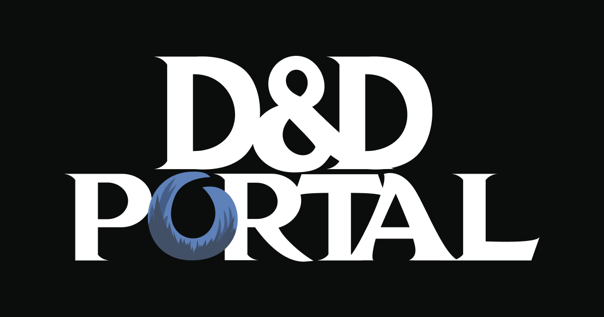

<div align="center">
  <picture>
    <source media="(prefers-color-scheme: dark)" srcset="player/static/dashboard-dnd-portal-logo-wide.svg">
    <source media="(prefers-color-scheme: light)" srcset="player/static/dashboard-dnd-portal-logo-wide-light.svg">
    
  </picture>

  <h1>D&amp;D Portal Dashboard</h1>

  <p>
    A secure, responsive campaign hub for players and organizers.<br>
    Plan sessions, answer polls, manage campaigns and keep everyone in one place.
  </p>

  <p>
    <a href="https://player.dnd-portal.com"><strong>Open the live dashboard</strong></a>
    ·
    <a href="https://github.com/dnd-portal/dnd-portal-dashboard/issues">Report an issue</a>
    ·
    <a href="https://github.com/dnd-portal/dnd-portal-dashboard/releases">Releases</a>
  </p>

  <p>
    
    
    
    
    <a href="https://github.com/dnd-portal/dnd-portal-dashboard/releases"></a>
  </p>
</div>



## About

D&amp;D Portal Dashboard is a full-stack web application for organizing tabletop campaigns. Players receive a personal invitation, create an account and use one dashboard for polls, availability, sessions, payments and campaign information. Organizers get a dedicated administration area for managing the portal and its members.

The production application is available at [player.dnd-portal.com](https://player.dnd-portal.com). Access is invitation-only; the public repository does not contain production accounts, data or credentials.

## Features

### Player experience

- Personal invitation-based registration
- Secure login with persistent sessions and CSRF protection
- Password recovery through time-limited personal reset codes
- Campaign overview, membership and session information
- Availability management and multi-select polls
- Payment-request and obligation overview
- Responsive desktop and mobile interface
- Full-screen, keyboard-accessible mobile navigation

### Organizer experience

- User, invitation and account management
- Global and campaign-specific polls with result views
- Campaign, membership, session and attendance administration
- Payment-request administration
- Activity history and rate-limit controls
- Mobile-friendly administration tables and layouts

## Technology

| Layer | Technology |
| --- | --- |
| Frontend | SvelteKit 3, Svelte 5, TypeScript 6, SCSS, Vite 8 |
| Backend | PHP 8.4, custom HTTP router and service layer |
| Database | MariaDB 11.4 with versioned SQL migrations |
| Testing | Node test runner and Playwright |
| Local environment | Docker Compose, PowerShell tooling and phpMyAdmin |
| Production | Static SvelteKit build with a PHP API on InfinityFree |

## Repository structure

```text
.
├── backend/                  PHP API, services, migrations and scripts
├── player/                   SvelteKit player and admin application
├── development/              Production-like preview configuration
├── scripts/portal/           Local development and release commands
└── docker-compose.v4.yml     MariaDB and preview services
```

The frontend-specific architecture and styling notes are documented in [`player/README.md`](player/README.md).

## Local development

### Prerequisites

- Node.js 24
- pnpm 11
- PHP 8.4 or newer
- Composer
- Docker Desktop with Docker Compose
- PowerShell

### Install dependencies

```powershell
git clone https://github.com/dnd-portal/dnd-portal-dashboard.git
cd dnd-portal-dashboard

pnpm --dir player install --frozen-lockfile
npm --prefix backend ci
composer --working-dir=backend install
```

Install the repository's `portal` command:

```powershell
powershell -NoProfile -ExecutionPolicy Bypass -File .\scripts\portal\install.ps1
```

Open a new PowerShell terminal and start the complete local environment:

```powershell
portal run-development-server
```

The command starts:

- Player application: `http://127.0.0.1:5174`
- PHP API: `http://127.0.0.1:8110`
- MariaDB: `127.0.0.1:3310`
- phpMyAdmin: `http://127.0.0.1:8096`

Useful commands:

```powershell
portal status
portal logs
portal open-phpmyadmin
portal reset-local-admin-password
portal restart
portal stop
```

On first start, `backend/.env.example` is copied to the ignored local file `backend/.env`. All values in the committed example files are development-only placeholders.

## Quality checks

Run the frontend checks from the repository root:

```powershell
pnpm --dir player format:check
pnpm --dir player check
pnpm --dir player test
pnpm --dir player build
```

Run the browser regression suite after installing Chromium:

```powershell
pnpm --dir player exec playwright install chromium
pnpm --dir player test:browser
```

Check backend formatting:

```powershell
npm --prefix backend run format:check
```

## Deployment

Production packages are built locally with:

```powershell
portal build-deployment
```

This process builds the frontend, stages the PHP runtime, generates the migration bundle, audits the package for forbidden development values and creates checksummed deployment artifacts under the ignored `release/` directory.

Deployment is intentionally manual. The production database and the private runtime configuration are never bundled or committed. Building a package does not upload files, change DNS or modify the live database.

## Security

- Never commit `.env`, `.env.infinityfree`, database exports, access tokens or real user data.
- Use the provided `.env.example` files only as local configuration templates.
- Keep production `server/.env` private on the hosting environment.
- Report suspected vulnerabilities privately to the repository owner instead of opening a public issue.

## Contributing

Issues and focused pull requests are welcome. Before submitting a change:

1. Keep production data and credentials out of commits, fixtures and screenshots.
2. Follow the existing four-space formatting and project structure.
3. Run the relevant format, type, test and build checks.
4. Describe the user-facing impact and verification steps clearly.

## Project status

D&amp;D Portal Dashboard is actively developed and used in production. Features and APIs may continue to evolve while the portal is expanded for additional campaigns and organizer workflows.

---

<div align="center">
  Built for better adventures, fewer scheduling messages and considerably less campaign chaos.
</div>
