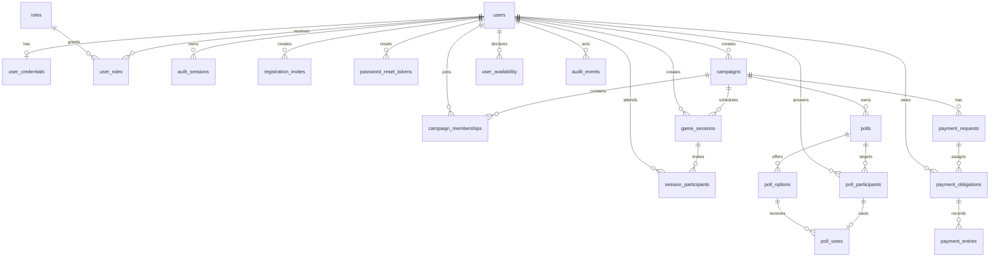

# Relaties

## Belangrijke invarianten

- Eén profiel blijft bestaan vóór en na registratie; `account_status` verandert van `invited` naar `active`.
- Login accepteert email of username, maar beide kolommen zijn afzonderlijk uniek na normalisatie. Een identifier die theoretisch met beide velden matcht, wordt geweigerd als ambigu; de applicatie mag geen willekeurige rij kiezen.
- Een campaign-DM is `campaign_memberships.membership_role='dm'`; portaladmin is uitsluitend `user_roles.role_key='portal_admin'`.
- Een afwezig `user_availability`-record betekent onbekend.
- Een poll vote vereist zowel een participant-record als een option van dezelfde poll.
- Dashboardtotalen komen uit query’s over deelnemers, obligations en entries.

